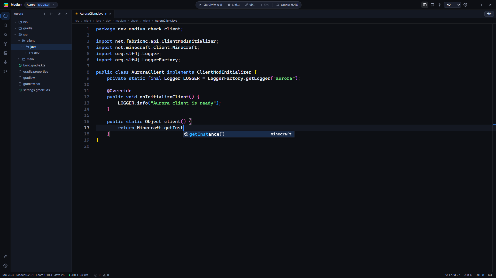
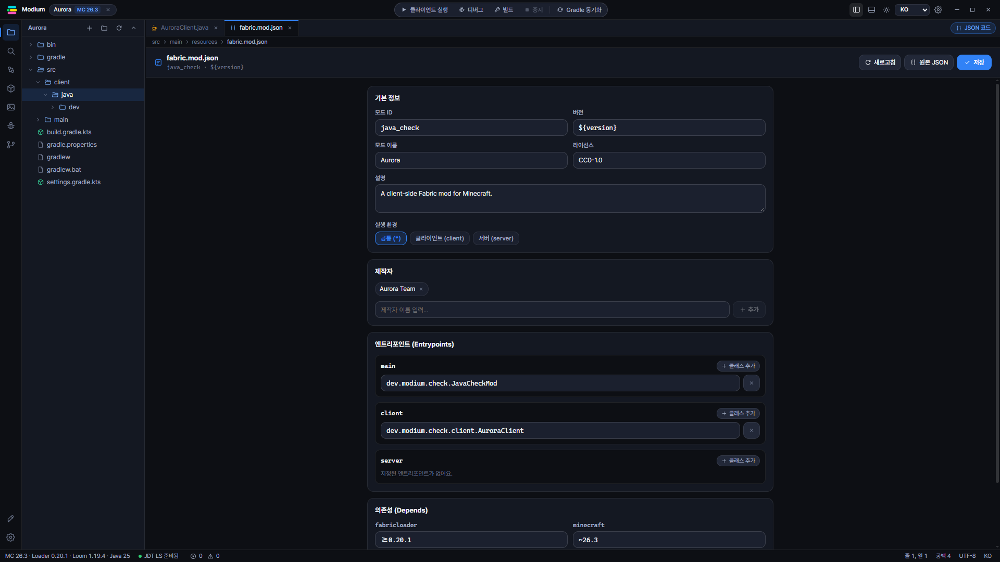

https://github.com/user-attachments/assets/6a24e536-1047-4af4-8adf-e54a94e17ebe

# Modium

Modium is a desktop IDE for building Minecraft mods with Fabric. Create a project, write Java against Minecraft sources, and launch a client under the debugger from the same workspace.

## Inside the editor

| Java completion | Mod metadata |
| --- | --- |
|  |  |

[Browse all 12 screenshots](docs/media/previews)

- **Set up a mod.** Generate a Fabric project for Minecraft 1.21.x or 26.x. Preview changes to Gradle, mod metadata, and Mixin configuration before migrating versions.
- **Navigate Java.** Find classes with `Ctrl+Shift+T`, open resources with `Ctrl+Shift+R`, and organize imports with `Ctrl+Shift+O`. Eclipse JDT LS provides completion, diagnostics, and navigation to declarations.
- **Debug a running client.** Set breakpoints, inspect variables, and step through Java code. Save a method body to apply supported changes to the running JVM.
- **Inspect mod files.** Browse Loom sources, inspect Mixin targets, preview textures, and edit `fabric.mod.json` as a form or as JSON.
- **Build and commit.** Run Gradle tasks, jump from compiler errors to source lines, review diffs, and stage changes in the workspace.

The interface supports English, Korean, Chinese, and Japanese, with light, dark, and system themes.

## Build from source

On Windows, install Rust with the MSVC toolchain, Microsoft C++ Build Tools, WebView2, Node.js, and pnpm. For developing mods, use JDK 21 for Minecraft 1.21.x or JDK 25 for 26.x.

```powershell
pnpm install --frozen-lockfile
pnpm tauri dev
```

To build the Windows installer, run `pnpm tauri build --bundles nsis`. The installer is written to `src-tauri/target/release/bundle/nsis/`. Use `pnpm tauri build --no-bundle` to build the executable alone.

## Development

The React and TypeScript interface lives in `src/`, including the Monaco editor integration. The Rust backend in `src-tauri/src/` manages Fabric projects, Gradle processes, the Java language server, and the debugger through Tauri 2.

```powershell
pnpm test
pnpm build
cargo test --manifest-path src-tauri/Cargo.toml
```

## License

[MIT](LICENSE)
